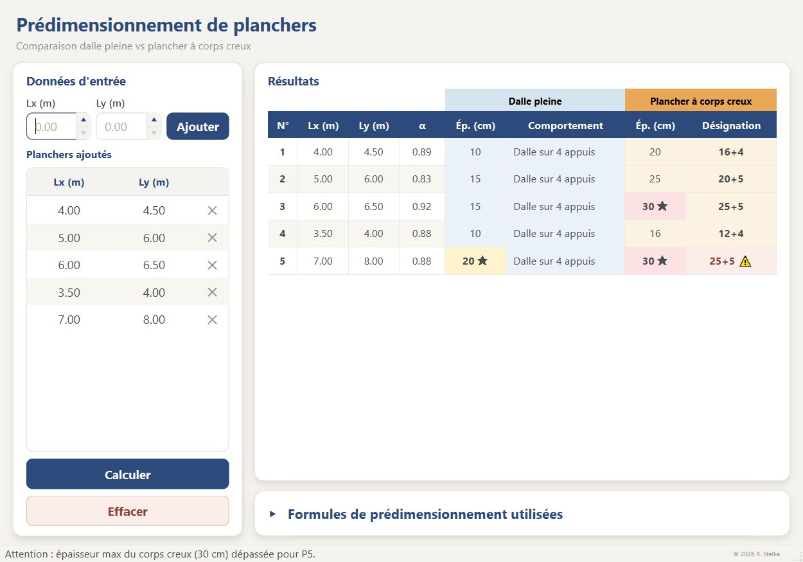

# Prédimensionnement de plancher — Dalle pleine & Corps creux

Prédimensionnement **comparatif** de planchers en béton armé : **dalle pleine**
vs **plancher à corps creux**. Pour chaque plancher saisi, l'outil calcule
l'épaisseur minimale nécessaire et son comportement structurel (distribution
des charges sur les appuis).

## Aperçu



*Exemple de calcul : cinq planchers saisis dans la colonne de gauche, résultats
comparatifs (dalle pleine vs corps creux) dans le tableau de droite. Les
épaisseurs maximales de chaque famille sont repérées par une étoile (★). Le
dernier plancher dépasse l'épaisseur maximale du corps creux (30 cm) : il est
signalé par un avertissement (⚠) dans le tableau et dans la barre d'état.*

## Installation

```bash
# Créer un environnement virtuel
python -m venv .venv
.venv\Scripts\activate      # Windows
# source .venv/bin/activate  # Linux / macOS

# Installer les dépendances
pip install -r requirements.txt
```

## Utilisation

Sans installation :

```bash
python main.py
```

Après installation du paquet (`pip install -e .`) :

```bash
predim-plancher
```

1. Saisissez les deux portées du plancher (en mètres) dans les champs
   **Lx (m)** et **Ly (m)** — au clavier, ou avec les flèches ▲ ▼ (pas de
   0,1 m). L'ordre n'a pas d'importance : la plus petite portée est
   automatiquement prise comme Lx.
2. Cliquez sur **Ajouter** (ou appuyez sur **Entrée**). Le plancher apparaît dans
   la liste **Planchers ajoutés**, où il peut être retiré avec le bouton **✕**.
3. Répétez l'opération pour chaque plancher, puis cliquez sur **Calculer**.
4. Le bouton **Effacer** vide la liste et les résultats.

Le panneau repliable **Formules de prédimensionnement utilisées** rappelle les
formules appliquées.

## Générer un exécutable (Windows)

Un script construit un binaire autonome (`.exe`) avec PyInstaller :

```bash
pip install pyinstaller
python scripts/build_exe.py
```

L'exécutable est produit dans `dist/`. Les fichiers intermédiaires (`build/`,
`*.spec`, icône générée) restent locaux et ne sont pas versionnés.

## Journalisation

L'application journalise chaque calcul et chaque interaction dans
`logs/predim.log` (rotation automatique, console en plus de l'application
lancée depuis un terminal). Le dossier `logs/` n'est pas versionné ; à côté de
l'exécutable lorsqu'elle est empaquetée, ou surchargeable via la variable
d'environnement `PREDIM_LOG_DIR`.

## Méthode de prédimensionnement

Avec `lx` la plus petite portée et `α = lx / ly` :

- **Dalle pleine** (épaisseur arrondie au multiple de 5 cm) :
  - `h = lx / 20` pour des appuis simples ;
  - `h = lx / 30` si α < 0,4 (portée dans un seul sens) ;
  - `h = lx / 40` si 0,4 ≤ α ≤ 1 (portée dans deux sens).
- **Corps creux** : `h = lx / 22,5`, calé sur le catalogue
  `12+4 / 16+4 / 20+5 / 25+5`.

## Licence

Distribué sous licence MIT — voir [LICENSE](LICENSE).
